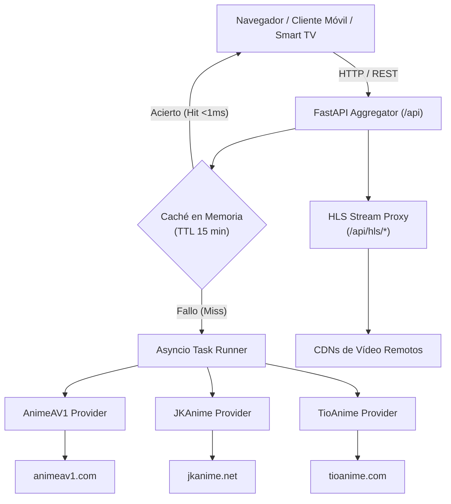

# 📖 AnimeStream Aggregator — Documentación Oficial de la API REST

Bienvenido a la documentación técnica de **AnimeStream API (v1.0.0)**. Este documento proporciona una referencia completa, detallada y actualizada de todos los endpoints, modelos de datos, parámetros de consulta, flujos de streaming HLS y mecanismos de caché del backend.

---

## 📑 Tabla de Contenidos
1. [Visión General y Arquitectura](#-visión-general-y-arquitectura)
2. [Entornos y Accesos Rápidos](#-entornos-y-accesos-rápidos)
3. [Convenciones, Códigos HTTP y Manejo de Errores](#-convenciones-códigos-http-y-manejo-de-errores)
4. [Política de Caché en Memoria (TTL 15 Min)](#-política-de-caché-en-memoria-ttl-15-min)
5. [Referencia de Endpoints](#-referencia-de-endpoints)
   - [1. Catálogo y Emisión](#1-catálogo-y-emisión)
     - [`GET /api/latest`](#get-apilatest)
   - [2. Búsqueda Multi-Fuente](#2-búsqueda-multi-fuente)
     - [`GET /api/search`](#get-apisearch)
   - [3. Directorio Filtrable](#3-directorio-filtrable)
     - [`GET /api/directory`](#get-apidirectory)
   - [4. Detalles del Anime](#4-detalles-del-anime)
     - [`GET /api/anime`](#get-apianime)
     - [`GET /api/anime/relations`](#get-apianimerelations)
   - [5. Sala de Reproducción y Streaming](#5-sala-de-reproducción-y-streaming)
     - [`GET /api/watch`](#get-apiwatch)
     - [`GET /api/hls/player/{hash_id}`](#get-apihlsplayerhash_id)
     - [`GET /api/hls/m3u8/{hash_id}`](#get-apihlsm3u8hash_id)
     - [`GET /api/hls/seg/{hash_id}/{filename}`](#get-apihlsseghash_idfilename)
     - [`GET /api/proxy-player`](#get-apiproxy-player)
   - [6. Biblioteca MyAnimeList](#6-biblioteca-myanimelist)
     - [`POST /api/library/parse-mal`](#post-apilibraryparse-mal)
     - [`GET /api/library/local-file`](#get-apilibrarylocal-file)
   - [7. Sistema y Caché](#7-sistema-y-caché)
     - [`GET /api/cache/stats`](#get-apicachestats)
     - [`POST /api/cache/clear`](#post-apicacheclear)
     - [`GET /api/image-proxy`](#get-apiimage-proxy)
6. [Diccionario de Esquemas y Modelos Pydantic](#-diccionario-de-esquemas-y-modelos-pydantic)

---

## 🏛️ Visión General y Arquitectura

AnimeStream funciona como una capa intermedia (*BFF - Backend for Frontend*) de alto rendimiento construida sobre **FastAPI** y **Python 3.10+**.



### Principios Fundamentales:
* **Scraping 100% Dinámico:** Sin bases de datos estáticas que queden obsoletas. Las fichas y capítulos se obtienen y unifican al momento.
* **Tolerancia a Fallos Multifuente (`Promise.allSettled`):** Si un portal cae o activa medidas anti-bot, la aplicación aísla el error y continúa funcionando con los datos de las demás fuentes.
* **Desacoplamiento Total:** Los controladores devuelven esquemas normalizados (`EpisodeItem`, `AnimeDetail`, etc.) independientemente de las diferencias en el DOM de origen.

---

## 🌐 Entornos y Accesos Rápidos

| Recurso | URL Local | Descripción |
| :--- | :--- | :--- |
| **Interfaz Web (SPA)** | `http://localhost:8000/` | Aplicación web para usuarios |
| **Acceso Red Local (LAN)** | `http://192.168.x.x:8000/` | Para teléfonos, tablets y Smart TVs |
| **Swagger UI Interactivo** | `http://localhost:8000/docs` | Consola para ejecutar y probar endpoints |
| **ReDoc Especificación** | `http://localhost:8000/redoc` | Documentación visual técnica |
| **Esquema OpenAPI JSON** | `http://localhost:8000/openapi.json` | Para importar en Postman / Insomnia |

---

## 🛡️ Convenciones, Códigos HTTP y Manejo de Errores

Todas las respuestas exitosas devuelven `Content-Type: application/json` (a excepción de los reproductores y flujos HLS que devuelven HTML o MIME de vídeo).

### Códigos de Estado Estándar
| Código | Significado | Causa común |
| :---: | :--- | :--- |
| **`200 OK`** | Operación exitosa | Petición procesada correctamente desde caché o scraping en vivo. |
| **`400 Bad Request`** | Parámetros inválidos | URL malformada, proveedor no soportado o archivo XML no reconocido. |
| **`404 Not Found`** | Recurso inexistente | Ruta no registrada o endpoint estático ausente. |
| **`502 Bad Gateway`** | Error en sitio de origen | El portal remoto (AnimeAV1, JKAnime o TioAnime) está caído o cambió su DOM. |

### Estructura de Error JSON
```json
{
  "detail": "URL no soportada. Debe pertenecer a animeav1.com, jkanime.net o tioanime.com"
}
```

---

## ⚡ Política de Caché en Memoria (TTL 15 Min)

Para proteger a los servidores de origen contra saturación y ofrecer respuestas instantáneas (<5ms), el backend incorpora un motor de caché thread-safe (`MemoryCache`):
* **TTL Predeterminado:** 900 segundos (15 minutos).
* **Granularidad de Claves:**
  * Portada: `latest_{source}`
  * Búsquedas: `search_{query}_{source}`
  * Catálogo: `dir_{genre}_{type}_{year}_{status}_{source}_{page}`
  * Ficha: `anime_{canonical_url}`
  * Episodio: `watch_{episode_url}`
* **Reinicio Dinámico:** Es posible purgarla en cualquier instante sin reiniciar el servidor mediante `POST /api/cache/clear`.

---

## 📚 Referencia de Endpoints

---

### 1. Catálogo y Emisión

#### `GET /api/latest`
Extrae en tiempo real los últimos episodios recién emitidos en las plataformas soportadas.

**Parámetros Query:**
| Parámetro | Tipo | Requerido | Por Defecto | Descripción |
| :--- | :---: | :---: | :---: | :--- |
| `source` | `string` | No | `"all"` | Proveedor de origen: `all`, `animeav1`, `jkanime`, `tioanime`. |

**Ejemplo de Petición cURL:**
```bash
curl -X GET "http://localhost:8000/api/latest?source=all" -H "Accept: application/json"
```

**Ejemplo de Respuesta (`200 OK`):**
```json
[
  {
    "title": "Sousou no Frieren 2nd Season",
    "episode": 4,
    "image": "https://cdn.animeav1.com/thumbnails/4497.jpg",
    "url": "https://animeav1.com/media/dark-machine-the-animation/2",
    "animeUrl": "https://animeav1.com/media/dark-machine-the-animation",
    "source": "AnimeAV1"
  },
  {
    "title": "One Piece",
    "episode": 1180,
    "image": "https://cdn.jkdesa.com/assets/images/animes/video/image_thumb/jkvideo_829d291a999fc7705554679a809bc446.jpg",
    "url": "https://jkanime.net/one-piece/1180/",
    "animeUrl": "https://jkanime.net/one-piece/",
    "source": "JKAnime"
  }
]
```

---

### 2. Búsqueda Multi-Fuente

#### `GET /api/search`
Búsqueda paralela y tolerante a fallos entre proveedores.

**Parámetros Query:**
| Parámetro | Tipo | Requerido | Por Defecto | Descripción |
| :--- | :---: | :---: | :---: | :--- |
| `q` | `string` | **Sí** | — | Término de búsqueda (mínimo 1 carácter). |
| `source` | `string` | No | `"all"` | Proveedor: `all`, `animeav1`, `jkanime`, `tioanime`. |

**Ejemplo de Petición cURL:**
```bash
curl -X GET "http://localhost:8000/api/search?q=Naruto&source=all" -H "Accept: application/json"
```

**Ejemplo de Respuesta (`200 OK`):**
```json
{
  "query": "Naruto",
  "results": [
    {
      "title": "Naruto Shippuden",
      "url": "https://tioanime.com/anime/naruto-shippuden",
      "image": "https://tioanime.com/uploads/thumbs/naruto-shippuden.jpg",
      "source": "TioAnime",
      "synopsis": "Naruto Uzumaki regresa a la aldea tras su largo entrenamiento...",
      "type": "TV Anime"
    },
    {
      "title": "Boruto: Naruto Next Generations",
      "url": "https://jkanime.net/boruto-naruto-next-generations/",
      "image": "https://cdn.jkdesa.com/assets/images/animes/image/boruto-naruto-next-generations.jpg",
      "source": "JKAnime",
      "synopsis": "Nuevas aventuras de los jóvenes ninjas en Konoha...",
      "type": "TV Anime"
    }
  ],
  "errors": []
}
```

---

### 3. Directorio Filtrable

#### `GET /api/directory`
Directorio unificado con filtros avanzados de categoría, formato, año y estado.

**Parámetros Query:**
| Parámetro | Tipo | Requerido | Por Defecto | Opciones / Ejemplos |
| :--- | :---: | :---: | :---: | :--- |
| `genre` | `string` | No | `null` | `accion`, `aventura`, `comedia`, `drama`, `fantasia`, `romance`, `sci-fi`, etc. |
| `type` | `string` | No | `null` | `tv`, `movie`, `ova`, `special`, `ona`. |
| `year` | `string` | No | `null` | Años entre `2026` y `2000`. |
| `status` | `string` | No | `null` | `emision`, `finalizado`. |
| `source` | `string` | No | `"all"` | `all`, `animeav1`, `jkanime`, `tioanime`. |
| `page` | `integer`| No | `1` | Número de página (mínimo `1`). |

**Ejemplo de Petición cURL:**
```bash
curl -X GET "http://localhost:8000/api/directory?genre=accion&status=emision&page=1"
```

**Ejemplo de Respuesta (`200 OK`):**
```json
{
  "items": [
    {
      "title": "Dragon Ball Super: Beerus",
      "url": "https://jkanime.net/dragon-ball-super-beerus/",
      "image": "https://cdn.jkdesa.com/assets/images/animes/image/dragon-ball-super-beerus.jpg",
      "source": "JKAnime",
      "type": "TV Anime",
      "status": "En emisión",
      "year": "2024",
      "genres": ["Acción", "Aventura", "Fantasía"]
    }
  ],
  "page": 1,
  "has_next": true,
  "total": 1
}
```

---

### 4. Detalles del Anime

#### `GET /api/anime`
Devuelve la ficha completa y la lista de todos los episodios para una URL canónica.

**Parámetros Query:**
| Parámetro | Tipo | Requerido | Descripción |
| :--- | :---: | :---: | :--- |
| `url` | `string` | **Sí** | URL completa del anime en AnimeAV1, JKAnime o TioAnime. |

**Ejemplo de Petición cURL:**
```bash
curl -X GET "http://localhost:8000/api/anime?url=https://jkanime.net/dragon-ball-super-beerus/"
```

**Ejemplo de Respuesta (`200 OK`):**
```json
{
  "title": "Dragon Ball Super: Beerus",
  "url": "https://jkanime.net/dragon-ball-super-beerus/",
  "image": "https://cdn.jkdesa.com/assets/images/animes/image/dragon-ball-super-beerus.jpg",
  "backdrop": null,
  "synopsis": "Nueva edición remasterizada con tecnología visual envolvente.",
  "genres": ["Acción", "Aventura", "Fantasía", "Shounen"],
  "status": "En emisión",
  "source": "JKAnime",
  "episodes": [
    {
      "number": 1,
      "title": "Episodio 1",
      "url": "https://jkanime.net/dragon-ball-super-beerus/1/",
      "image": null
    },
    {
      "number": 2,
      "title": "Episodio 2",
      "url": "https://jkanime.net/dragon-ball-super-beerus/2/",
      "image": null
    }
  ],
  "relations": [
    {
      "title": "Dragon Ball Super: Super Hero",
      "relation": "Secuela",
      "raw_relation": "Sequel",
      "type": "Película",
      "image": "https://cdn.myanimelist.net/r/50x70/images/anime/1109/122047.jpg",
      "mal_id": 48903,
      "mal_url": "https://myanimelist.net/anime/48903/Dragon_Ball_Super__Super_Hero"
    }
  ]
}
```

#### `GET /api/anime/relations`
Consulta MyAnimeList para obtener todas las secuelas, precuelas, películas, OVAs y spin-offs de la franquicia.

**Parámetros Query:**
| Parámetro | Tipo | Requerido | Descripción |
| :--- | :---: | :---: | :--- |
| `title` | `string` | **Sí** | Título del anime a buscar en MyAnimeList. |

**Ejemplo de Petición cURL:**
```bash
curl -X GET "http://localhost:8000/api/anime/relations?title=Naruto"
```

**Ejemplo de Respuesta (`200 OK`):**
```json
[
  {
    "title": "Naruto: Shippuuden",
    "relation": "Secuela",
    "raw_relation": "Sequel",
    "type": "TV",
    "image": "https://cdn.myanimelist.net/r/50x70/images/anime/1565/111305.jpg",
    "mal_id": 1735,
    "mal_url": "https://myanimelist.net/anime/1735/Naruto__Shippuuden"
  },
  {
    "title": "Naruto Movie 1: Dai Katsugeki!! Yuki Hime Ninpouchou Dattebayo!",
    "relation": "Historia paralela",
    "raw_relation": "Side story",
    "type": "Anime",
    "image": null,
    "mal_id": 442,
    "mal_url": "https://myanimelist.net/anime/442/Naruto_Movie_1__Dai_Katsugeki_Yuki_Hime_Ninpouchou_Dattebayo"
  }
]
```

---

### 5. Sala de Reproducción y Streaming

#### `GET /api/watch`
Extrae los servidores de vídeo embebidos y enlaces de navegación para un capítulo.

**Parámetros Query:**
| Parámetro | Tipo | Requerido | Descripción |
| :--- | :---: | :---: | :--- |
| `url` | `string` | **Sí** | URL completa del capítulo en la web fuente. |

**Ejemplo de Petición cURL:**
```bash
curl -X GET "http://localhost:8000/api/watch?url=https://jkanime.net/dragon-ball-super-beerus/2/"
```

**Ejemplo de Respuesta (`200 OK`):**
```json
{
  "animeTitle": "Dragon Ball Super: Beerus",
  "episode": 2,
  "url": "https://jkanime.net/dragon-ball-super-beerus/2/",
  "animeUrl": "https://jkanime.net/dragon-ball-super-beerus/",
  "image": "https://cdn.jkdesa.com/assets/images/animes/video/image_thumb/jkvideo_a378ee299a8f0f56f60bef587e56eadf.jpg",
  "source": "JKAnime",
  "prevUrl": "https://jkanime.net/dragon-ball-super-beerus/1/",
  "nextUrl": null,
  "servers": [
    {
      "name": "Desu",
      "embed": "https://jkanime.net/jkplayer/um?e=..."
    },
    {
      "name": "Magi",
      "embed": "https://jkanime.net/jkplayer/umv?e=..."
    }
  ]
}
```

---

---

#### `GET /api/hls/player/{hash_id}`
Página HTML embebible con reproductor HLS (`hls.js`) configurado.

**Parámetros Path:**
| Parámetro | Tipo | Descripción |
| :--- | :---: | :--- |
| `hash_id` | `string` | Hash identificador del vídeo. |

**Salida:** `text/html; charset=utf-8` con reproductor 16:9 responsive.

---

#### `GET /api/hls/m3u8/{hash_id}`
Descarga la lista de reproducción `.m3u8` original con cabeceras `Referer` y `Origin` válidas, reescribiendo los segmentos hacia el servidor local.

**Salida:** `application/vnd.apple.mpegurl` con cabeceras `Access-Control-Allow-Origin: *`.

---

#### `GET /api/hls/seg/{hash_id}/{filename}`
Proxy para fragmentos binarios de vídeo MPEG-TS (`.ts`) con caché de navegador de 24 horas.

**Salida:** `video/mp2t` binario.

---

#### `GET /api/proxy-player`
Proxy HTML que despoja cabeceras restrictivas `Content-Security-Policy` y `X-Frame-Options` para permitir incrustar reproductores con protecciones anti-iframe.

**Parámetros Query:**
| Parámetro | Tipo | Requerido | Descripción |
| :--- | :---: | :---: | :--- |
| `url` | `string` | **Sí** | URL del reproductor a incrustar. |
| `ref` | `string` | No | Cabecera Referer requerida por el reproductor. |

---

### 6. Biblioteca MyAnimeList

#### `POST /api/library/parse-mal`
Importa y procesa una exportación de MyAnimeList (`.xml` o `.xml.gz`).

**Parámetros Multipart:**
| Campo | Tipo | Requerido | Descripción |
| :--- | :---: | :---: | :--- |
| `file` | `UploadFile` | **Sí** | Archivo `.xml` o `.xml.gz` descargado desde MyAnimeList. |

**Ejemplo de Petición cURL:**
```bash
curl -X POST "http://localhost:8000/api/library/parse-mal" \
  -F "file=@animelist.xml.gz"
```

**Ejemplo de Respuesta (`200 OK`):**
```json
{
  "username": "denis",
  "total": 253,
  "stats": {
    "watching": 12,
    "completed": 145,
    "on_hold": 5,
    "dropped": 3,
    "plan_to_watch": 88
  },
  "animes": [
    {
      "id": "52991",
      "title": "Sousou no Frieren",
      "type": "TV",
      "totalEpisodes": 28,
      "watchedEpisodes": 28,
      "score": 10,
      "status": "completed",
      "statusLabel": "Visto",
      "updatedAt": "2024-03-24"
    }
  ]
}
```

---

#### `GET /api/library/local-file`
Escanea automáticamente carpetas habituales (`Downloads`, `Desktop`, `Documents`) y carga el archivo `animelist*.xml.gz` más reciente.

**Ejemplo de Respuesta (`200 OK`):**
```json
{
  "found": true,
  "filename": "animelist_1792544888_-_18719935.xml.gz",
  "path": "C:\\Users\\denis\\Downloads\\animelist_1792544888_-_18719935.xml.gz",
  "username": "denis",
  "total": 253,
  "stats": {
    "watching": 12,
    "completed": 145,
    "on_hold": 5,
    "dropped": 3,
    "plan_to_watch": 88
  },
  "animes": [ ... ]
}
```

---

### 7. Sistema y Caché

#### `GET /api/cache/stats`
Métricas de rendimiento de la memoria caché.

**Ejemplo de Respuesta (`200 OK`):**
```json
{
  "total_keys": 42,
  "hits": 128,
  "misses": 42,
  "hit_ratio": 0.75,
  "default_ttl": 900,
  "sample_keys": [
    "latest_all",
    "dir_accion_none_none_none_all_1"
  ]
}
```

---

#### `POST /api/cache/clear`
Vacía inmediatamente la memoria caché interna.

**Ejemplo de Respuesta (`200 OK`):**
```json
{
  "message": "Caché en memoria limpiada exitosamente"
}
```

---

#### `GET /api/image-proxy`
Proxy de imágenes con simulación de cabeceras de navegador y persistencia local de 7 días.

**Parámetros Query:**
| Parámetro | Tipo | Requerido | Descripción |
| :--- | :---: | :---: | :--- |
| `url` | `string` | **Sí** | URL remota de la carátula o captura. |

---

## 📐 Diccionario de Esquemas y Modelos Pydantic

| Modelo | Archivo Fuente | Propósito |
| :--- | :--- | :--- |
| **`EpisodeItem`** | [`backend/app/models.py`](file:///d:/Proyectos%20personales/Anime/backend/app/models.py#L7-L38) | Representa un episodio publicado en portada. |
| **`SearchResultItem`** | [`backend/app/models.py`](file:///d:/Proyectos%20personales/Anime/backend/app/models.py#L41-L76) | Tarjeta individual de anime coincidente en búsqueda. |
| **`SearchResponse`** | [`backend/app/models.py`](file:///d:/Proyectos%20personales/Anime/backend/app/models.py#L84-L113) | Contenedor de búsqueda con resultados y fallbacks de error. |
| **`EpisodeRef`** | [`backend/app/models.py`](file:///d:/Proyectos%20personales/Anime/backend/app/models.py#L116-L131) | Referencia ligera a un episodio en la lista técnica. |
| **`AnimeDetail`** | [`backend/app/models.py`](file:///d:/Proyectos%20personales/Anime/backend/app/models.py#L134-L177) | Ficha técnica completa de un anime con lista de episodios. |
| **`VideoServer`** | [`backend/app/models.py`](file:///d:/Proyectos%20personales/Anime/backend/app/models.py#L180-L192) | Servidor de vídeo disponible (nombre y URL embebible). |
| **`WatchDetail`** | [`backend/app/models.py`](file:///d:/Proyectos%20personales/Anime/backend/app/models.py#L195-L231) | Datos completos de la sala de reproducción de un episodio. |
| **`DirectoryItem`** | [`backend/app/models.py`](file:///d:/Proyectos%20personales/Anime/backend/app/models.py#L234-L265) | Tarjeta de anime en el catálogo filtrable. |
| **`DirectoryResponse`** | [`backend/app/models.py`](file:///d:/Proyectos%20personales/Anime/backend/app/models.py#L268-L295) | Respuesta paginada del directorio. |
| **`MALAnimeItem`** | [`backend/app/models.py`](file:///d:/Proyectos%20personales/Anime/backend/app/models.py#L298-L323) | Ficha de anime procesada de MyAnimeList. |
| **`MALStats`** | [`backend/app/models.py`](file:///d:/Proyectos%20personales/Anime/backend/app/models.py#L326-L343) | Contadores agrupados por estado en MyAnimeList. |
| **`MALParseResponse`** | [`backend/app/models.py`](file:///d:/Proyectos%20personales/Anime/backend/app/models.py#L346-L387) | Resultado de importación de lista MyAnimeList. |
| **`CacheStatsResponse`** | [`backend/app/models.py`](file:///d:/Proyectos%20personales/Anime/backend/app/models.py#L390-L411) | Métricas de rendimiento de la memoria caché. |
| **`MessageResponse`** | [`backend/app/models.py`](file:///d:/Proyectos%20personales/Anime/backend/app/models.py#L414-L416) | Mensaje simple de confirmación de operaciones. |
| **`ErrorDetail`** | [`backend/app/models.py`](file:///d:/Proyectos%20personales/Anime/backend/app/models.py#L419-L421) | Estructura estándar para respuestas HTTP de error. |
